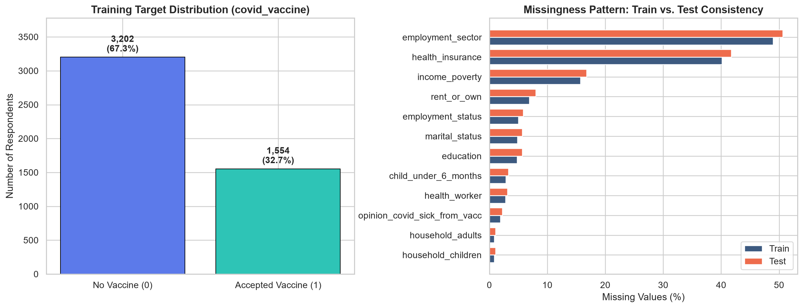
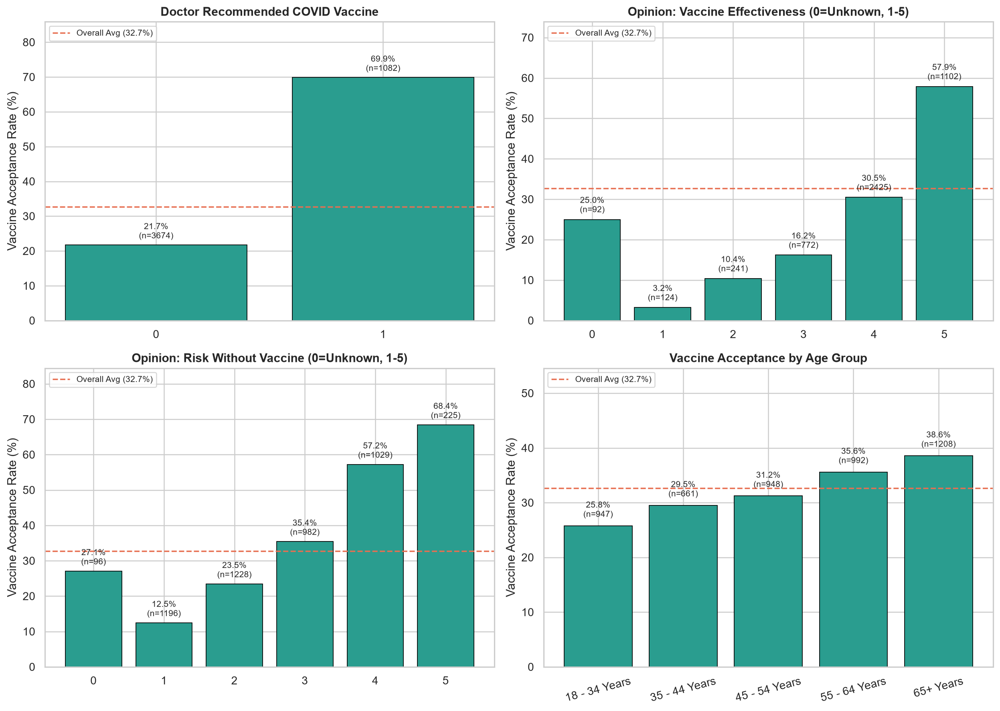
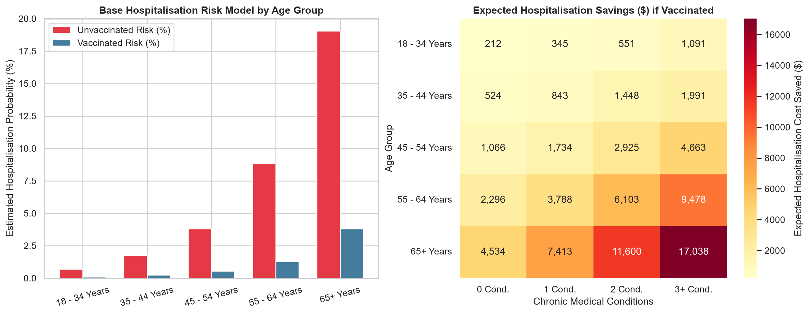
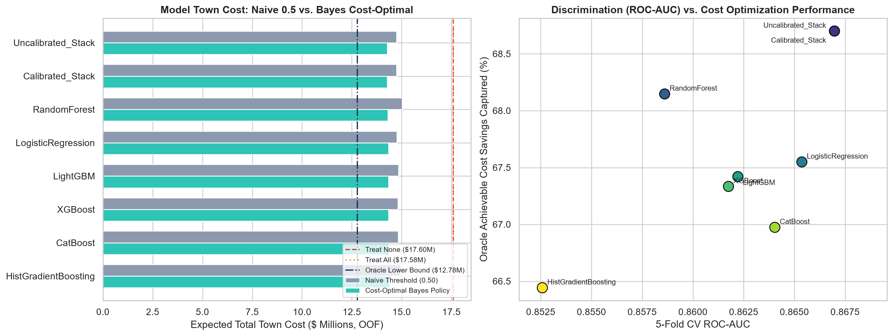
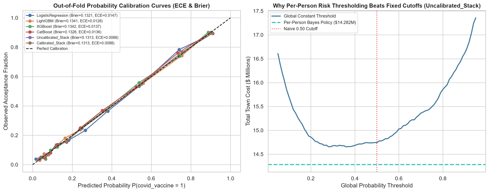
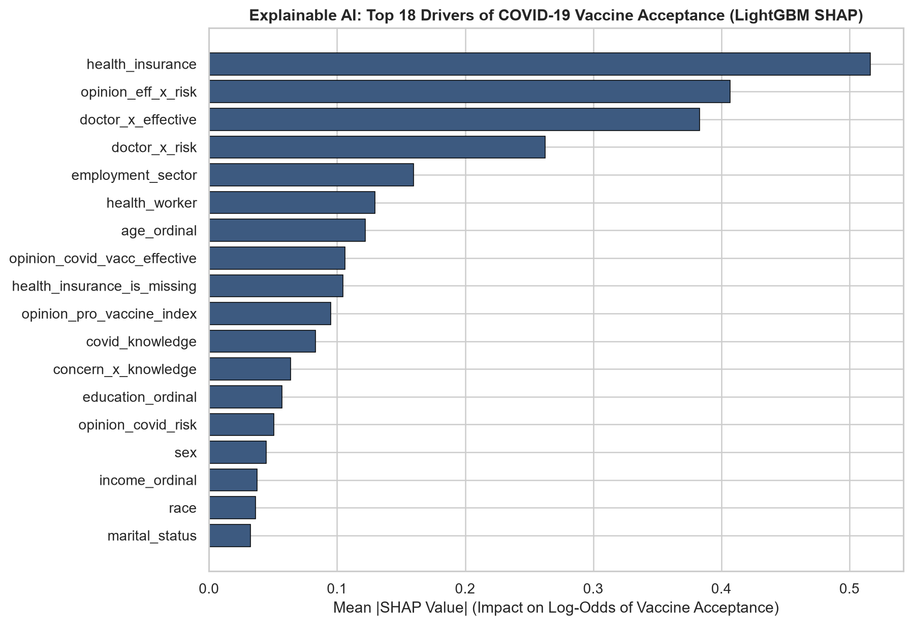
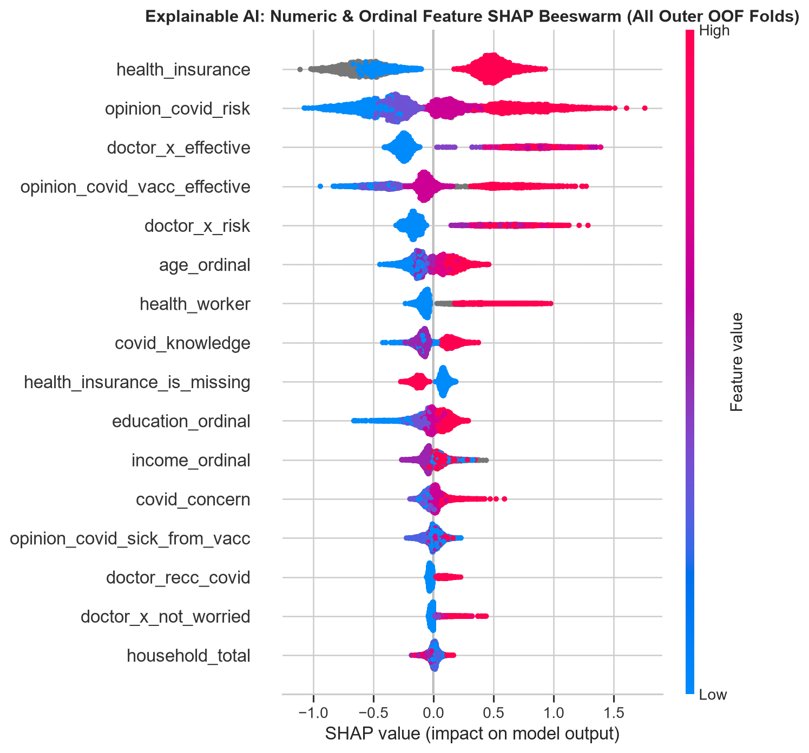
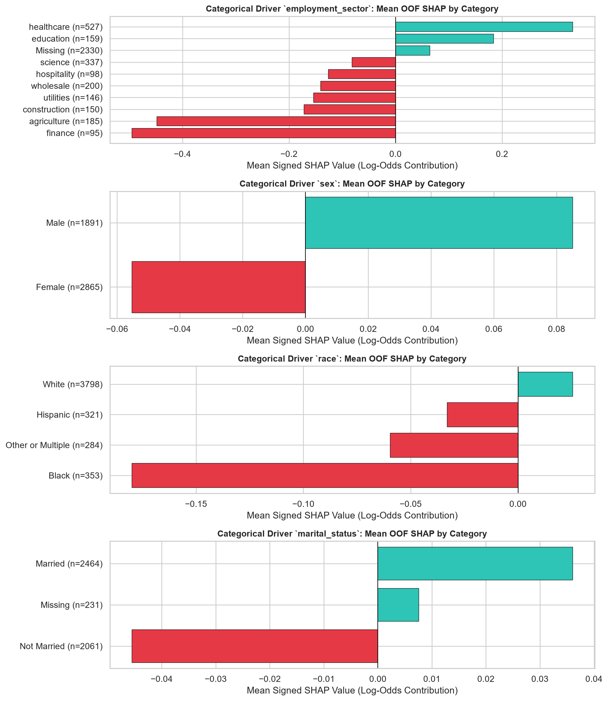
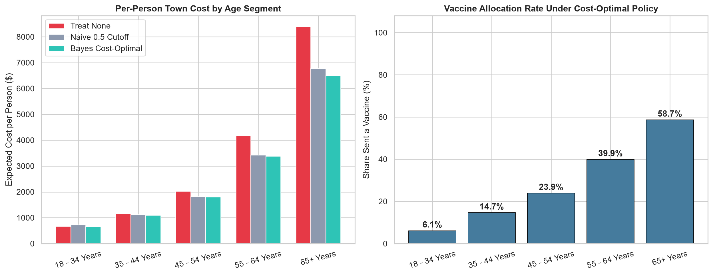
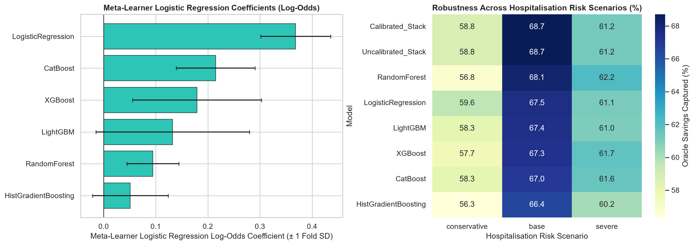

# RMDS Data Science Challenge Hackathon — Presentation Deck (Dataset C)

Slide-by-slide presentation outline ready for your team's pitch deck, backed directly by verified CV metrics and figures in `outputs/figures/`.

---

## Slide 1: Problem Statement & Town Cost Objective
* **Challenge:** Predict individual COVID-19 vaccine acceptance (`covid_vaccine` in `{0, 1}`) on `4,749` test respondents (`4,756` labeled training rows).
* **Real Goal (`Target Metric Information`):** Minimize **Total Town Cost** under 100% winter-party infection:
  * **Vaccine Cost:** `\$1,500` per shipped dose (spoils if unused) OR paid to willing citizens who don't receive one (local law).
  * **Hospitalisation Cost:** `\$41,000` per hospitalised resident.
* **Core Insight:** Because missed high-risk acceptors cost up to `\$14,600` in expected hospitalisations while a wasted dose costs `\$1,500`, **a fixed `0.50` classification cutoff leaves money on the table**.

---

## Slide 2: Dataset Quirks & Exploratory Insights
* **Target Balance:** `32.67%` accepted (`1,554` / `4,756`), `67.33%` declined (`3,202`).
* **3 Hidden Data Signals We Discovered:**
  1. **Informative Missingness:** Respondents missing `health_insurance` (~40–42% of rows) accept at only **17.3%** (`n=1,908`), vs. **45.8%** for insured respondents (`n=2,544`).
  2. **Doctor Recommendation Power:** `doctor_recc_covid = 1` triples acceptance from **21.7%** to **69.9%**.
  3. **Data Cleaning Fixes:** Fixed double spacing in `"MSA, Not Principle  City"` and flagged undocumented `0`s (`92` train / `107` test in effectiveness; `96` train / `104` test in risk) as `*_is_zero` + `NaN`.

---

## Slide 3: Hospitalisation Risk Matrix & Bayes-Optimal Decision Rule
* **Literature-Grounded Hospitalisation Estimates (Modelled, No Direct Outcome in Dataset C):** Estimated $p_{\text{hosp, unvacc}}(x_i)$ and $p_{\text{hosp, vacc}}(x_i)$ anchored to `Herrera-Esposito & de los Campos (2022)` + `Verity et al. (2020)` (age IHR), `Ko et al. (2021)` (chronic conditions $\ge 3$ aRR $= 5.0$), modest sex scaling (`Peckham 2020`, `OpenSAFELY 2020`), and `Tenforde et al. (2021)` + `Ferdinands et al. (2022)` vaccine effectiveness (`86%` standard, `80%` high-frailty; unsupported socioeconomic multipliers removed).
* **Exact Break-Even Threshold:** Send vaccine ($\hat{y}_i = 1$) whenever predicted acceptance probability satisfies:
  $$\hat{p}_i \ge \tau^*(x_i) = \frac{C_v}{C_v + C_h \cdot \big(p_{\text{hosp, unvacc}}(x_i) - p_{\text{hosp, vacc}}(x_i)\big)}$$
* **Why It Works (Real Audited Test Examples):**
  * **High-Risk Senior (`ID=4759`, 65+ Male, 0 chronic):** `p_unvacc=16.91%`, `p_vacc=3.38%`, break-even $\tau^* = 21.29\%$, model $\hat{p} = 28.57\%$ → **Send (`1`)** (naive `0.50` misses `\$5,546` expected hospitalisation savings).
  * **Low-Risk Young Adult (`ID=4763`, 18–34 Male, 0 chronic):** `p_unvacc=0.72%`, `p_vacc=0.10%`, break-even $\tau^* = 85.54\%$, model $\hat{p} = 54.16\%$ → **Don't Send (`0`)** (naive `0.50` risks `\$1,500` spoilage for only `\$254` expected savings).

---

## Slide 4: Multi-Model Benchmark (Leakage-Free Nested 5x4 Stratified CV)
* Trained **6 distinct model families** (`LogisticRegression`, `RandomForest`, `HistGradientBoosting`, `LightGBM`, `XGBoost`, `CatBoost`) + nested cross-fitted **`Uncalibrated_Stack` / `Calibrated_Stack`** over `49` ablation-validated features (pruning 5 noisy opinion composites).
* **Nested Stack achieved #1 across every classification & cost metric** (isolated nested calibration confirmed uncalibrated L2 logit stacking needed no Platt/Isotonic warp in 5/5 folds):
  * **ROC-AUC:** `0.8670` | **LogLoss:** `0.4173` | **Brier:** `0.1313` | **ECE:** `0.0088`
  * **Town Cost (OOF):** **`\$14,281,676`** (`\$3,002.88/person`, `1,487` allocated, `491` wasted, `558` law payouts, `273.5` expected hospitalisations)
  * **Savings:** **`\$3,318,874`** vs. Treat None (`\$17.60M`), **`\$3,299,690`** vs. Treat All (`\$17.58M`), and **`\$458,727`** saved over a fixed `0.50` threshold (`\$14.74M`)—capturing **68.7%** of theoretical oracle savings.

---

## Slide 5: Explainable AI (5-Fold OOF SHAP Stability & Segment Impact)
* **Top Global Drivers (OOF Mean `|SHAP| ± Fold SD`):** `health_insurance` (`0.533 ± 0.060`), `opinion_covid_risk` (`0.455 ± 0.069`), `doctor_x_effective` (`0.381 ± 0.040`), `opinion_covid_vacc_effective` (`0.292 ± 0.013`), `doctor_x_risk` (`0.256 ± 0.075`), `employment_sector` (`0.164 ± 0.034`, categorical), `age_ordinal` (`0.133 ± 0.022`), `health_worker` (`0.131 ± 0.010`).
* **Allocation Shift Across Ages:** Bayes policy targets **58.7%** of `65+ Years` vs. only **6.1%** of `18–34 Years` on OOF validation.

---

## Slide 6: Robustness Check & Top 5 Canvas Submissions
* **Cross-Scenario & VE Sensitivity:** Tested `conservative` (`0.5x`), `base` (`1.0x`), and `severe` (`1.5x`) risk profiles alongside `waned_omicron` (`65%/55%`), `base` (`86%/80%`), `boosted` (`91%/86%`) VE regimes—Bayes policy saved `$147k–$824k` over fixed `0.50` across every single regime, and `Calibrated_Stack` captured **58.8% / 68.7% / 61.2%** of oracle savings across the 3 scenarios.
* **Top 5 Exported Diverse Submissions (`submissions/`):**
  1. `Calibrated_Stack` (`bayes_exact`, nested inner-CV calibrator=`none`, `1,555` test vaccines / `32.7%`)
  2. `CatBoost` (`bayes_scaled=0.895`, `1,663` / `35.0%`)
  3. `RandomForest` (`bayes_exact`, `1,505` / `31.7%`)
  4. `LightGBM` (`bayes_scaled=1.16`, `1,315` / `27.7%`)
  5. `LogisticRegression` (`bayes_exact`, `1,589` / `33.5%`)

